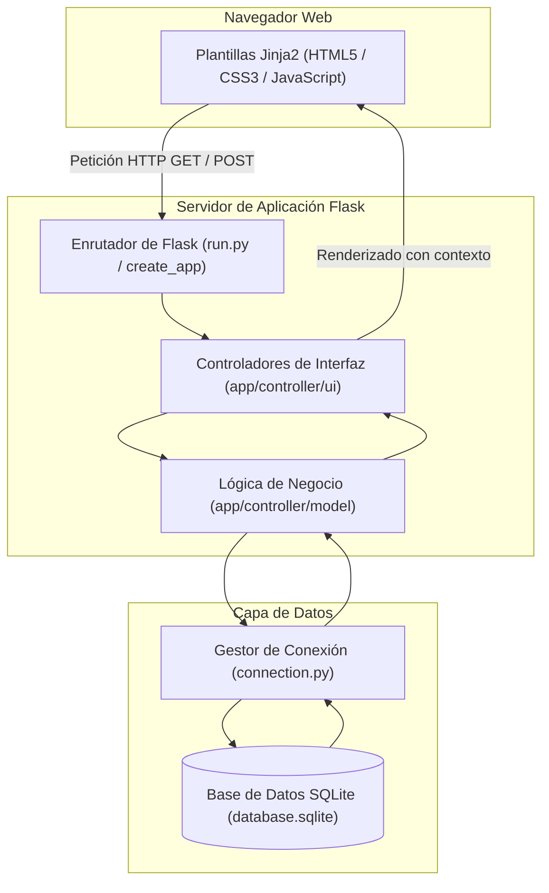
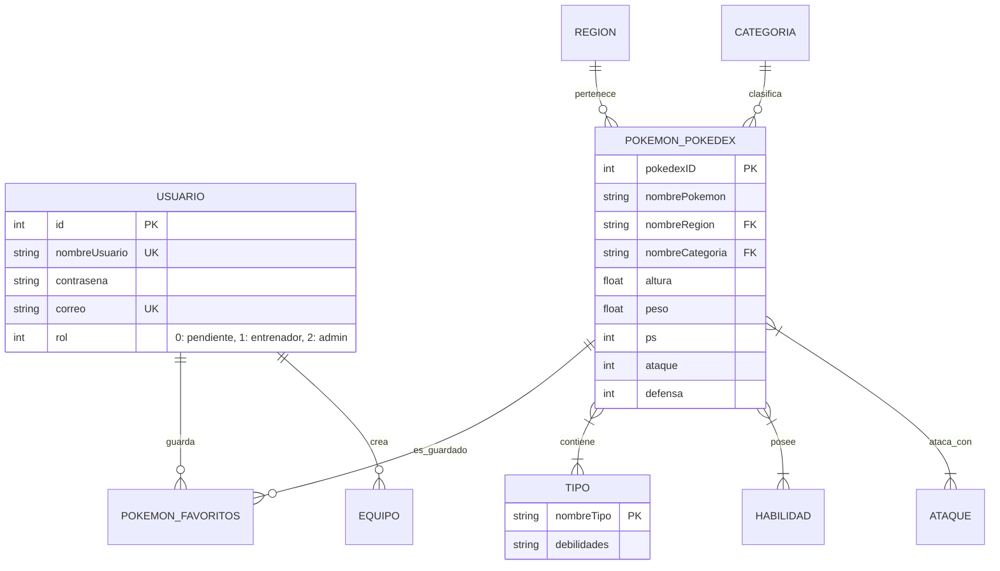

# Pokédex MVC con Flask y SQLite

<p align="left">
  
  
  
  
  
  
</p>

Aplicación web interactiva estructurada bajo el patrón de arquitectura Modelo-Vista-Controlador (MVC), desarrollada en Python utilizando el microframework Flask y persistencia sobre SQLite3. El sistema gestiona un catálogo completo de Pokémon, control de acceso basado en roles (RBAC), gestión de equipos personalizados, sistema de seguidores y un módulo de asistente virtual (ChatBot).

---

## Índice
- [Descripción general](#descripción-general)
- [Arquitectura del sistema](#arquitectura-del-sistema)
- [Modelo de datos](#modelo-de-datos)
- [Módulos funcionales](#módulos-funcionales)
- [Usuarios de prueba](#usuarios-de-prueba)
- [Estructura del proyecto](#estructura-del-proyecto)
- [Instalación y puesta en marcha](#instalación-y-puesta-en-marcha)
- [Ejecución de pruebas](#ejecución-de-pruebas)
- [Equipo](#equipo)
- [Contexto académico](#contexto-académico)

---

## Descripción general

El proyecto fue desarrollado como parte de la asignatura Análisis y Diseño de Sistemas de Información (ADSI). La aplicación desacopla por completo la capa de presentación (plantillas Jinja2 y recursos estáticos) de la lógica de controladores y el acceso a datos.

Aspectos técnicos destacados:
- Separación MVC estricta con controladores independientes de lógica de negocio y controladores de interfaz web.
- Esquema relacional con integridad referencial (`PRAGMA foreign_keys = ON`) y claves foráneas en cascada.
- Control de acceso por roles: usuarios pendientes de validación, entrenadores registrados y administradores.
- Automatización de carga de datos mediante script de consumo y volcado (`volcar_pokedex.py`).
- Suite de pruebas automatizadas con Pytest para la validación de controladores y modelos.

---

## Arquitectura del sistema

La aplicación procesa las solicitudes web siguiendo el flujo clásico MVC:



---

## Modelo de datos

El esquema relacional definido en `app/database/schema.sql` organiza la información en tablas normalizadas con claves compuestas y foráneas:



---

## Módulos funcionales

- **Gestión de Identidad y Roles:** Registro de usuarios con fecha de nacimiento y avatar, flujo de aprobación de cuentas por parte de administradores y restricción de rutas según el rol autenticado.
- **Catálogo de Pokédex:** Visualización de fichas de Pokémon con estadísticas base, evoluciones, tipos elementales, habilidades y filtros por región geográfica.
- **Equipos y Favoritos:** Creación de listas personalizadas de Pokémon y guardado de favoritos por usuario.
- **Interacción Social:** Módulos de seguimiento entre entrenadores (seguidores y seguidos) con tablón de notificaciones del sistema.
- **Asistente ChatBot:** Asistente integrado en la interfaz para consultas rápidas sobre el universo Pokémon y navegación de la plataforma.

---

## Usuarios de prueba

Para facilitar la evaluación de los distintos roles y permisos del sistema, la base de datos precargada contiene las siguientes credenciales:

| Rol | Nombre de usuario | Contraseña | Permisos |
| :--- | :--- | :--- | :--- |
| Administrador | `admin_jefe` | `admin123` | Gestión de usuarios, administración del catálogo y notificaciones |
| Entrenador | `ash_ketchum` | `pikachu` | Acceso a la Pokédex, gestión de equipos propios y favoritos |

---

## Estructura del proyecto

```text
ADSI_PokeGatas/
├── app/
│   ├── controller/
│   │   ├── model/             # Lógica de dominio y acceso a datos
│   │   ├── ui/                # Controladores de vistas y rutas HTTP
│   │   └── tests/             # Batería de pruebas unitarias
│   ├── database/
│   │   ├── connection.py      # Gestor de conexiones con SQLite
│   │   └── schema.sql         # Esquema de base de datos DDL
│   ├── static/
│   │   ├── css/ y js/         # Estilos y scripts (incluye chatbot.js)
│   │   └── img/               # Sprites, iconos y recursos de regiones
│   └── templates/             # Plantillas HTML con motor Jinja2
│       ├── admin/             # Vistas de administración
│       └── team/              # Vistas de gestión de equipos
├── config.py                  # Configuración de la aplicación
├── run.py                     # Punto de entrada del servidor Flask
├── requirements.txt           # Dependencias del proyecto
├── database.sqlite            # Base de datos SQLite preconfigurada
├── volcar_pokedex.py          # Script de extracción e inicialización
└── documentación.pdf          # Memoria técnica completa del proyecto
```

---

## Instalación y puesta en marcha

### Requisitos previos
- Python 3.12 o superior.

### 1. Clonar el repositorio
```bash
git clone https://github.com/28ivan/pokedex-flask-mvc.git
cd pokedex-flask-mvc
```

### 2. Configurar entorno virtual (recomendado)
En Windows (PowerShell):
```powershell
python -m venv venv
.\venv\Scripts\Activate.ps1
```

En Linux / macOS:
```bash
python3 -m venv venv
source venv/bin/activate
```

### 3. Instalar dependencias
```bash
pip install -r requirements.txt
```

### 4. Iniciar el servidor
```bash
python run.py
```
Acceder a la aplicación desde el navegador en `http://localhost:5000`.

Nota: El repositorio ya cuenta con `database.sqlite` precargada con datos. En caso de requerir una regeneración limpia, se puede eliminar dicho archivo y ejecutar `python volcar_pokedex.py`.

---

## Ejecución de pruebas

Para ejecutar la suite de pruebas unitarias implementadas:
```bash
pytest app/controller/tests
```

---

## Equipo

Proyecto desarrollado de forma colaborativa por:
- **[Iván Herrera](https://github.com/28ivan)**
- Daniel Talmaci
- June Castro
- Lou Marine Gomez
- David Miguez

---

## Contexto académico

Proyecto desarrollado para la asignatura de **Análisis y Diseño de Sistemas de Información (ADSI)** en el **Grado en Ingeniería Informática de Gestión y Sistemas de Información** de la **Universidad del País Vasco (UPV/EHU)**.
